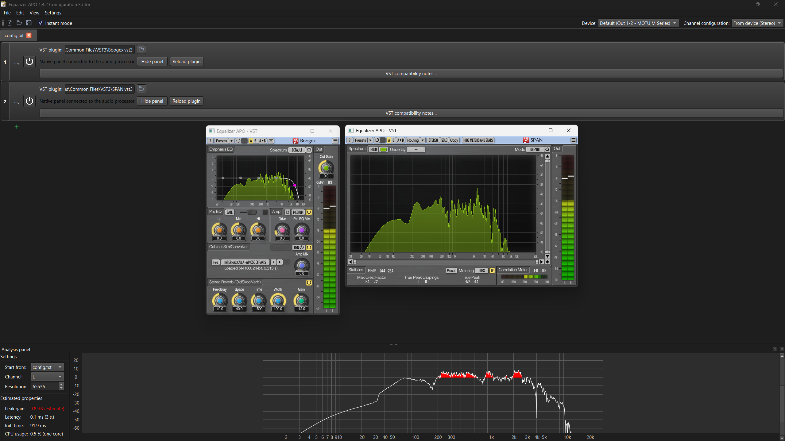

# Equalizer APO 64 with VST3 support

<div align="center">
  <a href="https://sourceforge.net/projects/eqapo64-with-vst3-support/">
    
  </a>
  &nbsp;&nbsp;
  <a href="https://sourceforge.net">
    
  </a>
</div>

**Branch: `v3-rewrite`.**

This repository is a restructured Windows fork based on [TheFireKahuna/equalizerAPO64](https://github.com/TheFireKahuna/equalizerAPO64), with the goal of keeping the familiar Equalizer APO workflow while adding
native VST3 plug-in support.



This branch is a rewrite of the VST engine from the **2.0.4 experimental branch**, preserving the familiar Configuration Editor, native audio tools and filter workflow.

*NOTE: This build was compiled for Windows 10/11 64 bits with AVX2 support only (More compatible with all CPUs). If you need AVX512 support, you'll need a compatible CPU and will have to compile it yourself from this repository.*

## Main Features

- Double-precision processing through the 64-bit internal pipeline for precision when applying multiple overlapping effects, including convolution, complex parametric EQ configurations and GraphicEQ curves.
- One isolated VST2/VST3 engine with native plug-in panels and live editing through the Steinberg VST3 SDK.
- Existing VST2 support retained for older plug-ins.
- Native EQ, pan, chorus, reverb, crossfeed, tone generator and VU meter.
- GraphicEQ FIR export and explicit IR/FIR sample-rate validation for
  convolution.
- Full parametric EQ module with unlimited filters, import and export options.
- Full Headphone Calibration module with a bundled ASH catalog generated from the
  [ASH-Toolset](https://github.com/ShanonPearce/ASH-Toolset) project by Shanon
  Pearce.
- Bundled various Free Impulse Responses inside the Convolution module. [Credits to Greg Hopkins
  (Hopkins Media Services) and [Aleksey Vaneev](https://github.com/avaneev) from [Voxengo](https://www.voxengo.com/)].
- Configuration Editor workflow preserved.
- Reproducible installer build using local dependencies under `third_party/`.
- NSIS-based safe installer packaging with multiple optional components for saving disk space and customize the installation.

## Changelog Compared With 2.0.4 Exp (12/10/26)

### Windows User Broker

The main change in this version is the common **Windows-user broker**: a
background process that connects the Windows audio engine to isolated VST
processors running in your signed-in account. In 2.0.4 exp, the traditional
loader ran effects inside the Windows audio service, while the experimental
loader offered a separate processing path. This branch uses one broker-based
engine for both VST2 and VST3.

- **Normal user profile:** the APO stays in LocalService, while plug-in processing
  and panels use the Windows account where you installed and activated the effects.
  Plug-ins can access their normal user settings and activation data without
  copying licenses into a service profile.
- **Automatic startup:** installation registers the broker at Windows sign-in;
  the editor also starts it when needed. There is no licensing switch, vendor list
  or choice between two VST modes. Keep the relevant Windows account signed in.
- **Protected audio engine:** plug-in code runs outside audiodg and the editor's
  main process. The engine supervises workers and can recover a failed processor
  while using aligned dry audio when wet processing is unavailable.
- **Live communication:** audio uses asynchronous buffers; controls and full
  preset state reach the active processor without making the audio callback wait
  for the panel or another process.
- **Preserved sessions:** compatible bypass/reactivation keeps the processor and
  panel available. A replacement processor receives the state and controls before
  taking over; explicit Reload requests a fresh instance.

This improves compatibility with effects that depend on the ordinary Windows-user
environment. Vendor activation is still required, and the broker does not guarantee
that every effect or DAW-specific feature is supported.

### VST Hosting

- Unifies the former in-process and out-of-process loaders into one VST module, without a mode selector.
- Runs plug-in audio and panels in the signed-in Windows account while keeping the APO in LocalService, allowing plug-ins to use their normal activation profile. No licensing toggle or vendor-specific setup is required.
- Starts the plug-in broker automatically at Windows sign-in and when needed by the editor.
- Keeps existing `VSTPlugin:` and `OutProcVSTPlugin:` configurations compatible; the editor saves the unified `VSTPlugin:` command.
- Updates the VST3 SDK to 3.8.1 build 84 and improves component/controller initialization, effect-class selection, channel layouts, auxiliary-bus handling and 32/64-bit audio precision negotiation.
- Improves live parameter delivery, grouped edits, plug-in restart requests and controls that save changes through preset state rather than ordinary automation.
- Improves full preset restoration and persistent effect/parameter identification across reopening, reloads and recovery.
- Keeps plug-in loading, scanning, panel operations and licensing dialogs outside the real-time audio callback.
- Isolates plug-in faults and adds automatic recovery, state restoration and dry fallback when processing is unavailable.

### Audio, Bypass And Panels

- Replaces blocking inter-process audio requests with asynchronous buffered processing.
- Improves latency reporting, dry/wet alignment, startup preparation and smooth transitions during processing changes.
- Keeps the current audio path active while preparing a replacement and preserves controls, state and panel connection during handoff.
- Retains compatible plug-in instances and windows during module bypass/reactivation, reducing repeated loading and lost panels.
- Keeps Show/Hide and window-close state connected during bypass, including other configuration edits; retained panels receive silent processing updates while bypassed, and reactivation reuses their compatible session.
- Avoids rebuilding the audio processor for every panel change and groups preset saves to reduce editing stutter.
- Separates panel visibility from plug-in lifetime; explicit Reload still creates a fresh instance.
- Brings VST panels in front of Configuration Editor when opened or shown, restoring minimized panels.
- Improves audio input for panel meters and Learn/Relearn features, native resizing and VST2 panels that report their size only after opening.
- Enables automatic application by default in the plug-in editing workflow.

### Configuration Editor And Native Audio Tools

- Fixes configuration saving when the file is writable but its parent folder prevents replacement, and improves handling of temporarily locked files.
- Simplifies VST compatibility notes into one window with clear items, without Show Details or vendor-specific actions.
- Improves per-monitor DPI handling, window placement, scalable icons, racks, toolbars and control sizing while preserving the editor layout.
- Improves module resets and right-click reset behavior for controls with defined defaults.
- Improves Analyzer startup, state synchronization and handling of outdated or unavailable results.
- Improves VU-meter updates, ownership and multichannel layout.
- Corrects neutral pan/stereo behavior, auxiliary biquad processing and FFT resource coordination.

### Installer And Build

- Widens the installer to display complete component names.
- Remembers optional choices for bundled IRs, headphone calibration data, expanded rack actions and restore-point creation.
- Preserves user-created or modified optional files when components are removed or updated.
- Removes UpdateChecker and makes the common Windows-user plug-in broker a standard part of installation.
- Improves runtime packaging and avoids mixing current binaries with older host copies.
- Adds root PS1/BAT launchers for a complete x64 installer build using bundled dependencies.
- Groups smoke tools in a separate directory with neutral, configurable plug-in paths.

## Current VST3 Status

VST compatibility depends on the effect. Your Windows account must remain signed in, and commercial plug-ins still require their normal vendor activation.

- Heavy plug-ins may take several seconds on their first load.
- Some controls, panels or presets may behave differently from a DAW.
- Adaptive or nonlinear effects may not produce a usable Analyzer curve.
- Independent external sidechain routing and a complete DAW transport are not provided.
- ASIO or exclusive audio streams that bypass Equalizer APO are not processed by it.

### VST Compatibility Notes

The VST module is not universally compatible with all VSTs on the market.

If you experience:

- A registered commercial VST asking for the license 
- Audio popping
- Editor.exe crashes and closes
- Audio changes you've made in the VST GUI aren't applied
- The GUI doesn't open when you click the button
- Audio artifacts or delays when processing changes

Then the VST is partially or completely incompatible with APO's architecture and the technical limitations of the Windows audio engine.

## About VST3 Plug-ins

VST3 effects may be single files or bundles. A Windows bundle commonly contains its binary at:

```text
PluginName.vst3/Contents/x86_64-win/PluginName.vst3
```

Select the public VST effect rather than an internal vendor DLL. If a bundle offers several effect classes, choose the one you want to use.

## Safety And Recovery

This installer registers an Audio Processing Object with selected Windows audio
devices. If Windows reports missing runtime DLLs, or if the Windows Audio service
becomes unstable after installation, remove Equalizer APO from the selected audio
devices first:

1. Open Equalizer APO Device Selector from the Start menu.
2. Uncheck all selected playback and capture devices.
3. Apply the change and reboot Windows if requested.
4. Then uninstall Equalizer APO normally.

When the restore-point component is selected, the installer attempts to create a
Windows restore point named `EqualizerAPO_<version>_PreInstall`. This is best-effort:
Windows may reject it when System Protection is disabled or another restore point
was recently created. The installer bundles the required x64 Visual C++ runtime
DLLs app-local and stops before modifying audio devices if the APO cannot be
registered.

## Installation

### Option A - Install From GitHub Releases

For normal users, install from the [GitHub Releases page](../../releases):

1. Download the installer.exe.
2. Run the installer and choose the optional components.
3. Choose the playback or capture devices that should use Equalizer APO.
4. Reboot Windows if the installer or Device Selector asks for it.
5. Open Configuration Editor and add filters as usual.
6. To use a plug-in, add a VST plug-in filter and select either a VST2 `.dll`
   or a VST3 `.vst3` bundle. VST audio and panels use the signed-in Windows account.

### Option B - Install From SourceForge

## Building

The build is designed to be reproducible from the repository root. Third-party
dependencies are kept locally under `third_party/`, so a global Qt or NSIS
installation is not required.

### Build Requirements

- Windows 10 or Windows 11 x64.
- Visual Studio 2022 with the Desktop development with C++ workload.
- A compatible Windows SDK installed through Visual Studio.
- Windows PowerShell 5.1 or newer.
- Python 3 available in PATH as `python.exe`.
- CMake 3.25 or newer for smoke tools or rebuilding muparserx.
- Internet access if missing Qt or NSIS tools need to be downloaded.

The source package includes the VST3 SDK sources needed by the host and smoke
fixtures, Qt/NSIS build tools, required Qt modules and audio dependency libraries.
Unused QML/Quick libraries, example applications, documentation bundles and
unrelated development tools are excluded. Dependency licenses are retained.
Keep `third_party/` intact when building; generated dependency builds go under
`third_party/build/` and are not versioned.

### One-command Installer Build

From the repository root:

```powershell
.\scripts\build-installer-x64.ps1 -Configuration Release
```

You can also double-click `build.bat` or run `build.ps1`. Use `-Rebuild` for an
application rebuild, or `-VisualStudioEdition Professional`, `Enterprise` or
`BuildTools` when using another Visual Studio 2022 edition.

The script performs the complete packaging flow:

- Prepares the local dependencies under `third_party/`.
- Builds the Equalizer APO x64 projects and unified VST host.
- Builds Qt-based applications such as Configuration Editor and Device Selector.
- Deploys the required Qt runtime files with `windeployqt`.
- Stages runtime files under `Setup/lib64`.
- Creates `EqualizerAPO-x64-1.4.2-with-VST3-support-V3.0.0.exe` under `output/installer/`.

Build logs are saved under `output/build/`.

### Smoke Tests

After building the application, run the smoke suite from the repository root:

```powershell
powershell -NoProfile -ExecutionPolicy Bypass -File .\SmokeTests\run-smoke.ps1 -Suite All -SmokeSeconds 60
```

You can also double-click `SmokeTests/run-smoke.bat`. The launcher builds the
test tools and runs:

- **Core:** configuration saving, parameter/control communication, state
  restoration and VST2/VST3 reference effects at different sample rates, channel
  layouts, block sizes and supported audio precision.
- **Transport:** the expected processed audio, declared latency and recovery
  when the plug-in worker fails.
- **Optional GUI and external effects:** add `-WithFixtureGui` for reference-effect
  panels, including meter updates while a retained session receives no audio,
  Hide/Show and reactivation with the same window; or use
  `-MatrixPath '<YOUR_MATRIX_JSON>'` for a completed copy of the plug-in
  path template in `SmokeTests/templates/`.

Use `-Suite Core` or `-Suite Transport` to run only that group. `SmokeSeconds`
accepts 1–60 and sets each transport trial's duration and external plug-in timeout;
the complete suite can take longer. Recovery requires at least 25 seconds.

Successful checks return zero and their reports show the expected processing,
state and recovery results. Failures stop the launcher and retain the logs under
`output/smoke/<timestamp>/`. The suite does not install the application or edit
your installed configuration, and it does not run automatically during a build.

Installed-device testing is separate and opt-in: `SmokeTests/run-live-smoke.ps1`
uses explicit installation paths, temporary test configurations and playback/
loopback device indices. It checks bypass, panel visibility, X-close, reactivation
and captured audio, then verifies restoration of the original configuration.
See the smoke README for dependencies and preparation; this test restarts Windows
Audio and requires elevation. It does not run from the normal smoke launcher.

See [SmokeTests/README.md](SmokeTests/README.md) for each test's purpose,
expected result and the optional diagnostic tools.

## License Summary

- Equalizer APO is distributed under the GNU General Public License. This fork is
  intended to be distributed under GPLv3-or-later where permitted by the original
  upstream licensing terms.
- Keep the original Equalizer APO copyright and license notices when
  redistributing binaries or source code.
- Steinberg VST3 SDK: used for VST3 hosting. License under MIT terms at `third_party/vst3sdk`.
- Other bundled dependencies retain their respective licenses. Commercial
  plug-ins and license data are not included.
- Microsoft MSVC / Visual Studio C++ toolchain: https://microsoft.com/
- C++ language created by Bjarne Stroustrup.
