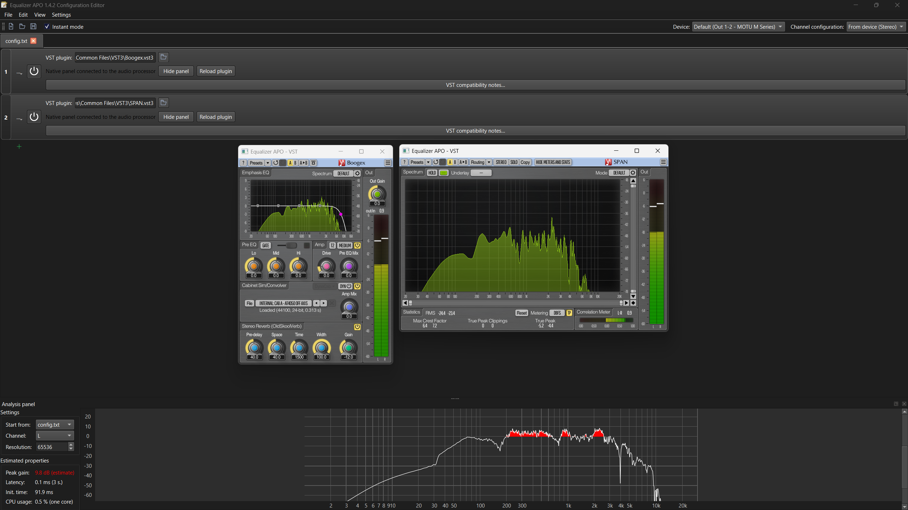

# Equalizer APO 64 with VST3 support

<div align="center">
  <a href="https://sourceforge.net/projects/eqapo64-with-vst3-support/">
    
  </a>
  &nbsp;&nbsp;
  <a href="https://sourceforge.net">
    
  </a>
</div>

**Branch: `v3-exp`.**

This repository is a restructured Windows fork based on [TheFireKahuna/equalizerAPO64](https://github.com/TheFireKahuna/equalizerAPO64), with the goal of keeping the familiar Equalizer APO workflow while adding
native VST3 plug-in support.



This branch is a rewrite of the VST engine from the **2.0.4 experimental branch**, preserving the familiar Configuration Editor, native audio tools and filter workflow.

*NOTE: This build was compiled for Windows 10/11 64 bits with AVX2 support only (More compatible with all CPUs). If you need AVX512 support, you'll need a compatible CPU and will have to compile it yourself from this repository.*

## Main Features

- Double-precision processing through the 64-bit internal pipeline for precision when applying multiple overlapping effects, including convolution, complex parametric EQ configurations and GraphicEQ curves.
- One unified VST2/VST3 module built on the Steinberg VST3 SDK 3.8.1, with native plug-in panels, live editing and full preset restoration. Existing VST2 plug-ins and older `VSTPlugin:`/`OutProcVSTPlugin:` configurations keep working.
- Plug-ins run in your signed-in Windows account through the Windows-user broker, outside the Windows audio service, so commercial plug-ins use their normal activation and settings.
- Isolated plug-in processing with automatic recovery: if a plug-in crashes, the engine restores its state and plays aligned dry audio until it is back.
- Low-latency buffered transport (one audio block of at least 10 ms per VST) and an optional per-VST **Zero latency (hybrid)** mode that adds no transport latency.
- Latency compensation and smooth configuration changes: processed and dry paths stay aligned, and changes crossfade without returning extra delay afterwards.
- Voicemeeter support (Voicemeeter, Banana and Potato outputs), including small ASIO buffers such as 128 samples.
- Flexible VST3 input/output layout negotiation for stereo, 5.1 and 7.1 devices, including plug-ins with different input and output channel counts.
- Plug-in panels that survive bypass and reactivation, with Show/Hide and Reload, and plug-in load diagnostics with the selected path and Windows error.
- Native EQ, pan, chorus, reverb, crossfeed, tone generator and VU meter.
- Full parametric EQ module with unlimited filters, import and export options.
- GraphicEQ FIR export and explicit IR/FIR sample-rate validation for convolution.
- Full Headphone Calibration module with a bundled ASH catalog generated from the
  [ASH-Toolset](https://github.com/ShanonPearce/ASH-Toolset) project by Shanon
  Pearce.
- Bundled various Free Impulse Responses inside the Convolution module. [Credits to Greg Hopkins
  (Hopkins Media Services) and [Aleksey Vaneev](https://github.com/avaneev) from [Voxengo](https://www.voxengo.com/)].
- Familiar Configuration Editor workflow, with an Analysis panel (frequency response, estimated latency, load time and CPU use), dark mode and per-monitor DPI support.
- NSIS-based safe installer with optional components, an optional restore point, and automatic start of the plug-in broker and Voicemeeter client after installation.
- Reproducible installer build using local dependencies under `third_party/`, and a smoke test suite.

## VST Limitations

> [!WARNING]
> **VST compatibility is not universal.** It depends on each plug-in and its vendor.
>
> - The Windows audio engine and Equalizer APO are not meant to run very complex or heavy VSTs. Equalizer APO is not a DAW and has no ASIO driver: all processing runs on the CPU inside the Windows audio path. See the [VST Compatibility Notes](#vst-compatibility-notes) and the compatibility notes in the VST module.
> - Plug-ins with a commercial license are not guaranteed to work.
> - The goal is near-universal compatibility, but every plug-in, computer and audio hardware is different.
>
> Please avoid opening issues about very specific problems caused by a heavy VST that the Windows audio engine cannot handle.

## Installation

### Option A - Install From GitHub Releases

For normal users, install from the [GitHub Releases page](../../releases):

1. Download the installer.exe.
2. Run the installer and choose the optional components.
3. Choose the playback or capture devices that should use Equalizer APO.
4. Open Configuration Editor and add filters as usual.
5. To use a plug-in, add a VST plug-in filter and select either a VST2 `.dll`
   or a VST3 `.vst3` bundle. VST audio and panels use the signed-in Windows account.

### Option B - Install From SourceForge

[](https://sourceforge.net/projects/eqapo64-with-vst3-support/files/3.0.5/EqualizerAPO-x64-1.4.2-with-VST3-support-V3.0.5.exe/download)

## Current VST3 Status

VST compatibility depends on the effect. Your Windows account must remain signed in, and commercial plug-ins still require their normal vendor activation.

- Heavy plug-ins may take several seconds on their first load.
- Some controls, panels or presets may behave differently from a DAW.
- Adaptive or nonlinear effects may not produce a usable Analyzer curve.
- Independent external sidechain routing and a complete DAW transport are not provided.
- ASIO or exclusive audio streams that bypass Equalizer APO are not processed by it.

### VST Compatibility Notes

The VST module is not universally compatible with all VSTs on the market.

If you experience:

- A registered commercial VST asking for the license 
- Audio popping
- Editor.exe crashes and closes
- Audio changes you've made in the VST GUI aren't applied
- The GUI doesn't open when you click the button
- Audio artifacts or delays when processing changes

Then the VST is partially or completely incompatible with APO's architecture and the technical limitations of the Windows audio engine.

### Zero Latency (Hybrid) Mode

By default each VST runs in its own process and its audio is buffered by one block of at least 10 ms (two if the VST falls behind). With **Zero latency (hybrid)** enabled in a VST module, the audio callback (Windows, or the Voicemeeter client) waits for that VST instead, so no transport latency is added. The plug-in's own reported latency still applies.

Pros:

- No added latency, useful for real-time monitoring, headphone correction and room correction.
- Plug-in isolation, licensing in your Windows account and crash recovery work as in the default mode.
- Falls back on its own: after 3 missed deadlines within 10 s the VST switches to buffered mode until the configuration is reloaded.

Cons:

- The audio thread waits for the VST in every block: up to 5 ms, or half a block for small buffers (about 1.3 ms at 128 samples). A missed deadline plays that block unprocessed, which can be heard as a click. Small buffers leave the VST very little time, so they are more sensitive to this.
- Heavy VSTs, CPU spikes, opening or resizing the panel, or a loaded system can cause those misses.
- Needs blocks of a constant size. If the block size changes, buffered mode is used. After a fallback with buffers below 10 ms, buffered mode keeps about 10 ms of headroom (640 samples at 128).
- Slightly higher CPU use, because the audio thread wakes the VST process for every block.

Leave it off if you do not need low latency or if you hear clicks.

## About VST3 Plug-ins

VST3 effects may be single files or bundles. A Windows bundle commonly contains its binary at:

```text
PluginName.vst3/Contents/x86_64-win/PluginName.vst3
```

Select the public VST effect rather than an internal vendor DLL. If a bundle offers several effect classes, choose the one you want to use.

## Safety And Recovery

This installer registers an Audio Processing Object with selected Windows audio
devices. If Windows reports missing runtime DLLs, or if the Windows Audio service
becomes unstable after installation, remove Equalizer APO from the selected audio
devices first:

1. Open Equalizer APO Device Selector from the Start menu.
2. Uncheck all selected playback and capture devices.
3. Apply the change and reboot Windows if requested.
4. Then uninstall Equalizer APO normally.

When the restore-point component is selected, the installer attempts to create a
Windows restore point named `EqualizerAPO_<version>_PreInstall`. This is best-effort:
Windows may reject it when System Protection is disabled or another restore point
was recently created. The installer bundles the required x64 Visual C++ runtime
DLLs app-local and stops before modifying audio devices if the APO cannot be
registered.

## Building

The build is designed to be reproducible from the repository root. Third-party
dependencies are kept locally under `third_party/`, so a global Qt or NSIS
installation is not required.

### Build Requirements

- Windows 10 or Windows 11 x64.
- Visual Studio 2022 with the Desktop development with C++ workload.
- A compatible Windows SDK installed through Visual Studio.
- Windows PowerShell 5.1 or newer.
- Python 3 available in PATH as `python.exe`.
- CMake 3.25 or newer for smoke tools or rebuilding muparserx.
- Internet access if missing Qt or NSIS tools need to be downloaded.

The source package includes the VST3 SDK sources needed by the host and smoke
fixtures, Qt/NSIS build tools, required Qt modules and audio dependency libraries.
Unused QML/Quick libraries, example applications, documentation bundles and
unrelated development tools are excluded. Dependency licenses are retained.
Keep `third_party/` intact when building; generated dependency builds go under
`third_party/build/` and are not versioned.

### One-command Installer Build

From the repository root:

```powershell
.\scripts\build-installer-x64.ps1 -Configuration Release
```

You can also double-click `build.bat` or run `build.ps1`. Use `-Rebuild` for an
application rebuild, or `-VisualStudioEdition Professional`, `Enterprise` or
`BuildTools` when using another Visual Studio 2022 edition.

The script performs the complete packaging flow:

- Prepares the local dependencies under `third_party/`.
- Builds the Equalizer APO x64 projects and unified VST host.
- Builds Qt-based applications such as Configuration Editor and Device Selector.
- Deploys the required Qt runtime files with `windeployqt`.
- Stages runtime files under `Setup/lib64`.
- Creates `EqualizerAPO-x64-1.4.2-with-VST3-support-V3.0.5.exe` under `output/installer/`.

Build logs are saved under `output/build/`.

### Smoke Tests

After building the application, run the smoke suite from the repository root:

```powershell
powershell -NoProfile -ExecutionPolicy Bypass -File .\SmokeTests\run-smoke.ps1 -Suite All -SmokeSeconds 60
```

You can also double-click `SmokeTests/run-smoke.bat`. The launcher builds the
test tools and runs:

- **Core:** configuration saving, parameter/control communication, state
  restoration and VST2/VST3 reference effects at different sample rates, channel
  layouts, block sizes and supported audio precision.
- **Transport:** the expected processed audio, declared latency and recovery
  when the plug-in worker fails.
- **Optional GUI and external effects:** add `-WithFixtureGui` for reference-effect
  panels, including meter updates while a retained session receives no audio,
  Hide/Show and reactivation with the same window; or use
  `-MatrixPath '<YOUR_MATRIX_JSON>'` for a completed copy of the plug-in
  path template in `SmokeTests/templates/`.

For only the neutral multichannel checks, run `powershell -NoProfile -ExecutionPolicy Bypass -File .\SmokeTests\run-multichannel-smoke.ps1`. It checks stereo/5.1/7.1 layouts, independent input/output buses, format changes and each output channel through owned workers. These checks are also included in Core.

Use `-Suite Core` or `-Suite Transport` to run only that group. `SmokeSeconds`
accepts 1–60 and sets each transport trial's duration and external plug-in timeout;
the complete suite can take longer. Recovery requires at least 25 seconds.

Successful checks return zero and their reports show the expected processing,
state and recovery results. Failures stop the launcher and retain the logs under
`output/smoke/<timestamp>/`. The suite does not install the application or edit
your installed configuration, and it does not run automatically during a build.

Installed-device testing is separate and opt-in: `SmokeTests/run-live-smoke.ps1`
uses explicit installation paths, temporary test configurations and playback/
loopback device indices. It checks bypass, panel visibility, X-close, reactivation
and captured audio, then verifies restoration of the original configuration.
See the smoke README for dependencies and preparation; this test restarts Windows
Audio and requires elevation. It does not run from the normal smoke launcher.

See [SmokeTests/README.md](SmokeTests/README.md) for each test's purpose,
expected result and the optional diagnostic tools.

## Changelog | 3.0.5 (22/11/2026)

- Lower VST latency (#1): each VST now adds one 10 ms audio block instead of two (about 10 ms less at 48 kHz). If the plug-in process falls behind, or Windows delivers audio in irregular block sizes, that VST switches back to two blocks automatically.
- New optional **Zero latency (hybrid)** mode per VST module, for real-time monitoring and headphone or room correction. The audio callback waits for the plug-in (up to 5 ms per block, or half a block if that is shorter), so no transport latency is added; only the plug-in's own latency remains. It also works with small buffers, such as Voicemeeter with an ASIO output at 128 samples. After 3 missed deadlines within 10 s the module switches to buffered mode until the configuration is reloaded. If an older plug-in broker is still running, the module uses buffered mode instead. It is saved as `ZeroLatency 1` on the `VSTPlugin:` line; older versions ignore it. Pros and cons are in [Zero Latency (Hybrid) Mode](#zero-latency-hybrid-mode) and in the VST compatibility notes of the Configuration Editor.
- Small audio buffers (for example Voicemeeter over ASIO at 128 samples): buffered VSTs now group the small blocks into one block of at least 10 ms that is a multiple of the buffer size (512 samples at 128), so blocks always end on a buffer boundary. Buffered latency stays about 20 ms there (18.7 ms at 48 kHz, 20.3 ms at 44.1 kHz); use Zero latency mode to remove it.
- Fixed latency that never went down after a configuration change. Changing the configuration crossfades the old and new filter chains at their common latency, but the new chain then kept that latency until the audio engine restarted. So after a buffered VST had been used once, every later configuration (even a simple Preamp, or a VST in Zero latency mode) kept its extra delay. The new chain now returns to its own latency with a 10 ms crossfade right after the change. This affected every output device, not only Voicemeeter.
- Measured on Voicemeeter Banana with an ASIO output at 128 samples (44.1 kHz), with a test plug-in that has 5.8 ms of its own latency: buffered mode adds 26.0 ms, Zero latency mode adds 5.9 ms (the plug-in's own latency only), and a Preamp adds nothing, also after a VST has been used. Before these fixes, all three added 26 ms.
- Fixed Voicemeeter processing stopping after an update until the next sign-in: the installer closed the Equalizer APO Voicemeeter client and did not start it again, so no filter or VST was applied to the Voicemeeter outputs. The installer now restarts it in your normal Windows account. Opened without arguments, `VoicemeeterClient.exe` uses the outputs you selected in Device Selector.
- The installer now also starts the updated plug-in broker in your normal (non-administrator) Windows account right after installation, so new engine features work without signing out or restarting.
- The Equalizer APO log records when Zero latency mode becomes active for a VST and why it switched to buffered mode.
- Tip for Voicemeeter: its output buses have 8 channels, so a stereo plug-in runs as four instances. Add a **Channel** module set to `L R` (`Channel: L R`) above the plug-in to run a single instance and reduce CPU use and load time.
- [for developers - compilation] Adds hybrid-mode and adaptive-latency timeline tests (including 64- and 128-sample blocks), a graph latency-release contract test, and zero-latency real-time transport runs (with and without forced worker crashes, and with 128-frame callbacks; `EqApoTransportSmoke --block N`) to the smoke suite.

## Changelog | 3.0.4 (21/11/2026)

- Fixed VST3 (and VST2) settings reverting to an older state after reopening Configuration Editor or restarting Windows. The newest panel state is now saved before modules are rebuilt (moving, adding, cloning or editing other rows, changing device), after hiding a panel, and when Windows logs off or shuts down.
- Saving the configuration while a VST panel is open no longer re-applies an older copy of the plug-in state over newer edits.
- VST3 plug-ins that start a parameter edit without finishing it no longer block state saving until the panel is closed.
- The state checkpoint taken before bypassing a VST module now actually reaches the plug-in.
- Fixed crackling, pops and high CPU usage while a VST panel is open with plug-ins that update meters or other output values continuously (for example Realphones). Forwarding those values to the panel no longer locks the plug-in, so audio blocks are no longer skipped while its GUI repaints. This applies to every output device; it was most noticeable with Voicemeeter (#1) because of its small buffers and because a stereo plug-in on an 8-channel bus runs as four instances. No changes to the Voicemeeter client were needed. To reduce CPU further on an 8-channel Voicemeeter bus, add `Channel: L R` before the plug-in so that a single instance is used.
- Hidden VST panels are no longer shown again by a configuration change unless Show panel is clicked (#9).
- Cloned VST modules get their own identity, and duplicate VST identities in a file are renamed, so two modules no longer control the same panel.
- The plug-in checker waits up to 20 s for slow-loading plug-ins, distinguishes a slow load from a crash, and removes its warning once the plug-in panel opens.
- VST module warnings, status text and convolution/include error labels are now readable in dark mode.
- Fixed the convolution module's path box stretching to the height of the File information box.
- [for developers - compilation] Adds a VST3 GUI-edit state round-trip probe and updates the panel visibility test to the 3.0.3 behavior.

## Changelog | 3.0.3 (16/10/2026)

- Normalizes the maximum response of bundled Voxengo IMreverbs to 0 dB when loaded, including existing configurations, while keeping the bundled source WAVs unchanged.
- Preserves VST3 input and output bus layouts in saved plug-in state, including distinct layouts that use the same number of channels, and restores them when the processor is recreated.
- Keeps bypass controls responsive while a VST panel is open and preserves the existing panel during worker handoff.
- Supports plug-in-declared resizing for VST3 editors while keeping VST2 editor windows fixed-size. The Maximize button is disabled to prevent VST GUI glitches.

## Changelog | 3.0.2 (14/10/2026)

- Fixed VST state persistence when closing and reopening Configuration Editor. The editor now flushes pending VST GUI edits through the module wrapper before shutdown and waits for pending configuration writes to finish.
- Preserves the current VST preset and parameters when bypassing and reactivating a module by saving a complete checkpoint before the configuration change.
- Keeps an open VST panel animated when other modules or filters change. The retained panel receives input from the replacement audio graph for its meters and visualizations; its output is discarded.
- Preserves VST parameters across audio stream changes, including newly created processing streams at different sample rates.
- [for developers - compilation] Adds neutral smoke coverage for editor restart, saved configuration state, bypass transitions, retained panel updates and new audio streams.

## Changelog | 3.0.1 (13/10/2026)

- Negotiates VST3 input and output layouts independently using the selected device's channel configuration. Supports stereo effects on multichannel devices and effects with stereo input and multichannel output, while retaining supported fixed layouts.
- Improves channel routing and preserves plug-in settings when the device channel configuration changes.
- Shows more specific plug-in loading errors, including the path and Windows error when available. Plug-ins can be selected from drives other than C:, including paths with spaces or Unicode characters.
- Fixes reopening a plug-in panel after closing it during bypass/reactivation, avoiding stale window state and orphaned panels.
- Speed-up the installation by removing the bundled online tutorial and configuration-reference shortcuts from the installer and cleans up shortcuts left by previous installations. 
-  [for developers - compilation] Adds a dedicated, configurable multichannel smoke suite covering stereo, 5.1 and 7.1 layouts, asymmetric input/output counts, routing, format changes and isolated processing. Generated test results remain outside the source tree.

## Changelog (3.0.0) Compared With 2.0.4 Exp (12/10/26)

### Windows User Broker

The main change in this version is the common **Windows-user broker**: a
background process that connects the Windows audio engine to isolated VST
processors running in your signed-in account. In 2.0.4 exp, the traditional
loader ran effects inside the Windows audio service, while the experimental
loader offered a separate processing path. This branch uses one broker-based
engine for both VST2 and VST3.

- **Normal user profile:** the APO stays in LocalService, while plug-in processing
  and panels use the Windows account where you installed and activated the effects.
  Plug-ins can access their normal user settings and activation data without
  copying licenses into a service profile.
- **Automatic startup:** installation registers the broker at Windows sign-in;
  the editor also starts it when needed. There is no licensing switch, vendor list
  or choice between two VST modes. Keep the relevant Windows account signed in.
- **Protected audio engine:** plug-in code runs outside audiodg and the editor's
  main process. The engine supervises workers and can recover a failed processor
  while using aligned dry audio when wet processing is unavailable.
- **Live communication:** audio uses asynchronous buffers; controls and full
  preset state reach the active processor without making the audio callback wait
  for the panel or another process.
- **Preserved sessions:** compatible bypass/reactivation keeps the processor and
  panel available. A replacement processor receives the state and controls before
  taking over; explicit Reload requests a fresh instance.

This improves compatibility with effects that depend on the ordinary Windows-user
environment. Vendor activation is still required, and the broker does not guarantee
that every effect or DAW-specific feature is supported.

### VST Hosting

- Unifies the former in-process and out-of-process loaders into one VST module, without a mode selector.
- Runs plug-in audio and panels in the signed-in Windows account while keeping the APO in LocalService, allowing plug-ins to use their normal activation profile. No licensing toggle or vendor-specific setup is required.
- Starts the plug-in broker automatically at Windows sign-in and when needed by the editor.
- Keeps existing `VSTPlugin:` and `OutProcVSTPlugin:` configurations compatible; the editor saves the unified `VSTPlugin:` command.
- Updates the VST3 SDK to 3.8.1 build 84 and improves component/controller initialization, effect-class selection, channel layouts, auxiliary-bus handling and 32/64-bit audio precision negotiation.
- Improves live parameter delivery, grouped edits, plug-in restart requests and controls that save changes through preset state rather than ordinary automation.
- Improves full preset restoration and persistent effect/parameter identification across reopening, reloads and recovery.
- Keeps plug-in loading, scanning, panel operations and licensing dialogs outside the real-time audio callback.
- Isolates plug-in faults and adds automatic recovery, state restoration and dry fallback when processing is unavailable.

### Audio, Bypass And Panels

- Replaces blocking inter-process audio requests with asynchronous buffered processing.
- Improves latency reporting, dry/wet alignment, startup preparation and smooth transitions during processing changes.
- Keeps the current audio path active while preparing a replacement and preserves controls, state and panel connection during handoff.
- Retains compatible plug-in instances and windows during module bypass/reactivation, reducing repeated loading and lost panels.
- Keeps Show/Hide and window-close state connected during bypass, including other configuration edits; retained panels receive silent processing updates while bypassed, and reactivation reuses their compatible session.
- Avoids rebuilding the audio processor for every panel change and groups preset saves to reduce editing stutter.
- Separates panel visibility from plug-in lifetime; explicit Reload still creates a fresh instance.
- Brings VST panels in front of Configuration Editor when opened or shown, restoring minimized panels.
- Improves audio input for panel meters and Learn/Relearn features, native resizing and VST2 panels that report their size only after opening.
- Enables automatic application by default in the plug-in editing workflow.

### Configuration Editor And Native Audio Tools

- Fixes configuration saving when the file is writable but its parent folder prevents replacement, and improves handling of temporarily locked files.
- Simplifies VST compatibility notes into one window with clear items, without Show Details or vendor-specific actions.
- Improves per-monitor DPI handling, window placement, scalable icons, racks, toolbars and control sizing while preserving the editor layout.
- Improves module resets and right-click reset behavior for controls with defined defaults.
- Improves Analyzer startup, state synchronization and handling of outdated or unavailable results.
- Improves VU-meter updates, ownership and multichannel layout.
- Corrects neutral pan/stereo behavior, auxiliary biquad processing and FFT resource coordination.

### Installer And Build

- Widens the installer to display complete component names.
- Remembers optional choices for bundled IRs, headphone calibration data, expanded rack actions and restore-point creation.
- Preserves user-created or modified optional files when components are removed or updated.
- Removes UpdateChecker and makes the common Windows-user plug-in broker a standard part of installation.
- Improves runtime packaging and avoids mixing current binaries with older host copies.
- Adds root PS1/BAT launchers for a complete x64 installer build using bundled dependencies.
- Groups smoke tools in a separate directory with neutral, configurable plug-in paths.

## License Summary

- Equalizer APO is distributed under the GNU General Public License. This fork is
  intended to be distributed under GPLv3-or-later where permitted by the original
  upstream licensing terms.
- Keep the original Equalizer APO copyright and license notices when
  redistributing binaries or source code.
- Steinberg VST3 SDK: used for VST3 hosting. License under MIT terms at `third_party/vst3sdk`.
- Other bundled dependencies retain their respective licenses. Commercial
  plug-ins and license data are not included.
- Microsoft MSVC / Visual Studio C++ toolchain: https://microsoft.com/
- C++ language created by Bjarne Stroustrup.
